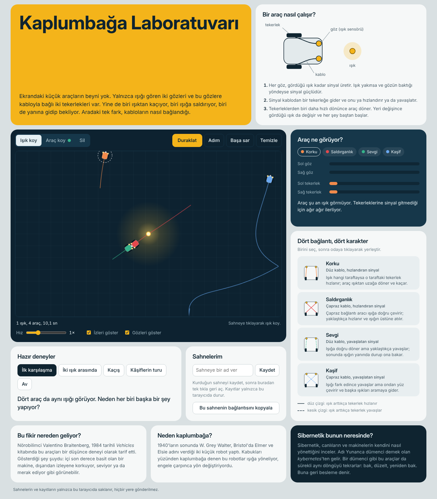

# Kaplumbağa Laboratuvarı

Braitenberg araçlarıyla tarayıcıda sibernetik deneyler. İki sensör, iki tekerlek, iki kablo: kabloları nasıl bağladığına göre araç ışıktan kaçar, ışığa saldırır, ışığın yanında durup ona "bakar" ya da onu fark edip başka yere gider. Hiçbir araç düşünmüyor; davranış yalnızca bağlantılardan doğuyor.

**Canlı site:** https://kaplumbaga-laboratuvari.vercel.app

**Yedek adres (GitHub Pages):** https://iroh19.github.io/kaplumbaga-laboratuvari/



## Ne yapabilirsin?

**Sayfa 1: Gerçek kaplumbağa (Grey Walter'ın robotu).** 1948-49'da yapılan Elmer ve Elsie'nin ne olduğunu, neden yapıldığını ve ne sonuç verdiğini, hiç bilgisi olmayanlar için anlatır. Etiketli bir kesit şeması, "beş kural" kartları, altı hazır deney (karanlık oda, tek lamba, engelin arkasındaki lamba, şarj kulübesi, ayna testi, iki kaplumbağa) ve robotun o an ne yaptığını düz Türkçeyle anlatan canlı bir panel içerir. Odaya kendi lamba ve engellerini koyabilirsin. Kaynaklar sayfanın sonunda. Bu model, kaynaklarda anlatılan davranışlara dayanan bir benzetimdir; hızlar ve eşikler bu projenin ayarlarıdır.

**Sayfa 2: Braitenberg araçları.**

- **Işık koy, araç koy, sil:** Sahneye tıklayarak deney kur.
- **Dört araç tipi:** Korku, Saldırganlık, Sevgi, Kaşif (Braitenberg'in 2a, 2b, 3a, 3b araçları). Her kartta göz-tekerlek bağlantı şeması var.
- **"Araç ne görüyor?" paneli:** Seçtiğin aracın iki gözünün gördüğü ışığı ve iki tekerleğinin hızını canlı gösterir, o an neden döndüğünü düz Türkçeyle açıklar.
- **Hazır deneyler:** Beş sahne, her birinde düşündüren bir soru.
- **Oynat, duraklat, adım adım ilerlet, başa sar.** Boşluk tuşu oynatır ve duraklatır. Hız 0,25× ile 3× arasında ayarlanabilir.
- **Sahnelerini kaydet:** Kayıtlar tarayıcıda (LocalStorage) saklanır, sayfa yenilenince kaybolmaz. Son çalıştığın sahne de otomatik saklanır.
- **Bağlantıyla paylaş:** Sahne adresin içine kodlanır; linki açan kişi aynı sahneyi görür. Sunucu ya da hesap gerekmez.

## Araçlar nasıl çalışıyor?

| Araç | Bağlantı | Etki | Davranış |
| --- | --- | --- | --- |
| Korku (2a) | düz | uyarıcı (+) | Işığın olduğu taraftaki tekerlek hızlanır, araç ışıktan uzağa döner. |
| Saldırganlık (2b) | çapraz | uyarıcı (+) | Araç ışığa döner, yaklaştıkça hızlanır ve ışığın üstüne atılır. |
| Sevgi (3a) | düz | baskılayıcı (−) | Işığa döner ama yaklaştıkça yavaşlar, yanında durur. |
| Kaşif (3b) | çapraz | baskılayıcı (−) | Işığı fark edince yavaşlar, ondan yüz çevirip başka yere gider. |

Her adımda: sensörler ışığı ölçer (yakınlık ve yöne göre) → bağlantılar tekerlek hızlarını belirler → araç diferansiyel sürüşle hareket eder → sensörler yeniden ölçer. Bu kapalı döngü, sibernetiğin temel fikri: geri besleme.

## Kurulum

Node.js 20.19 veya üstü gerekir.

```bash
npm install       # bağımlılıkları kur
npm run dev       # geliştirme sunucusu: http://localhost:5173
npm test          # simülasyon çekirdeklerinin testleri (42 test)
npm run build     # yayın için dist/ klasörünü üret
```

## Yayına alma

**Vercel:** GitHub deposunu Vercel'de "Add New → Project" ile içe aktar. Vite otomatik tanınır; ayar gerekmez.

**Netlify:** Build command `npm run build`, publish directory `dist`.

**GitHub Pages:** `vite.config.js` içinde `base: "./"` ayarlı olduğu için `dist/` klasörü alt dizinde de çalışır.

## Kullanılan teknolojiler

- **React 19** ve **Vite 7**
- **Saf CSS** (çerçeve yok), bento ızgara yerleşimi (CSS Grid), **Canvas 2D API** ile çizim
- Yazı tipleri: Archivo (başlıklar) ve IBM Plex Sans (metin), Google Fonts üzerinden
- **LocalStorage** ile kayıt, **URL hash** ile paylaşım
- **Node.js yerleşik test aracı** (`node:test`), ek test kütüphanesi yok

## Kod nasıl düzenlendi?

Simülasyon çekirdeği (`src/sim/world.js`), *Systematic Program Design* kursundaki tasarım tarifiyle yazıldı: önce veri tanımları, sonra her fonksiyon için imza ve amaç, sonra örnekler (testler), en son gövde. Bütün fonksiyonlar saf: girdiyi değiştirmez, yeni değer döndürür.

Uygulama, SPD'deki *big-bang* "world program" yapısında çalışır:

| SPD kavramı | Bu projede |
| --- | --- |
| World (dünya durumu) | `World`: ışıklar, araçlar, zaman |
| `on-tick` | `tick(world, dt)` |
| `to-draw` | `drawWorld(ctx, world)` |
| `on-mouse` | `handleClick(world, x, y, tool, type)` |

```
src/
  sim/
    tortoise.js      Walter'ın kaplumbağası: davranış kuralları, oda, hazır deneyler
    tortoise.test.js Kaplumbağa testleri
    tdraw.js         Kaplumbağa odasının canvas çizimi
    vehicles.js      Dört araç tipinin tanımı
    world.js         Veri tanımları ve saf simülasyon fonksiyonları
    world.test.js    Örnekler / testler
    draw.js          Canvas çizimi
  TortoiseLab.jsx    Kaplumbağa sayfası (açıklamalar, deney odası, canlı panel)
  components/
    TortoiseAnatomy.jsx  Etiketli kaplumbağa kesiti
    WorldCanvas.jsx  Canvas ve tıklama → dünya koordinatı
    WiringDiagram.jsx  Bağlantı şeması
    SignalPanel.jsx  Canlı sinyal çubukları ve düz Türkçe açıklama
    Anatomy.jsx      Aracın parçalarını gösteren etiketli şema
  App.jsx            Döngü, araç çubuğu, kenar çubuğu
  presets.js         Hazır deneyler
  storage.js         LocalStorage ve paylaşım bağlantısı
```

## Yapay zeka kullanımı

Geliştirme sürecinde Claude (Anthropic) kullanıldı.

| Aşama | Yapay zeka nasıl kullanıldı |
| --- | --- |
| Fikir ve planlama | Sibernetik, robotik ve SPD ilgi alanlarından proje fikri çıkarıldı; veri modeli, ekranlar ve kapsam birlikte planlandı. |
| Kod üretimi | Simülasyon çekirdeği, testler, React bileşenleri ve CSS üretildi. |
| Doğrulama | Davranışlar sayısal simülasyonla ölçüldü (ör. Sevgi aracı ışığa ne kadar yaklaşıyor); uygulama başsız Chromium'da uçtan uca test edildi. |
| Hata ayıklama | Aşağıdaki sorunlar testlerle ve ekran görüntüleriyle bulunup düzeltildi. |
| Dokümantasyon | Bu README'nin taslağı hazırlandı. |

**Yapay zeka destekli hata ayıklamada bulunan sorunlar:**

1. **Sevgi aracı ışığın içinden geçip gidiyordu.** Işık tam karşıdayken iki sensör de ona 45° açıyla baktığı için okuma aracı durduracak kadar yükselmiyordu. Baskılayıcı bağlantılar için ayrı ve daha güçlü bir kazanç tanımlandı.
2. **Kaşif tam simetrik durumda takılıp kalıyordu.** Gerçek robotlarda olduğu gibi tekerlekler arasına küçük, sabit bir fark (±%1,5) eklendi.
3. **Araçların izi hiç çizilmiyordu.** Kenar sarma fonksiyonu kayan nokta hatası yüzünden aralıktaki sayıları da çok az değiştiriyor, kod her adımda "araç kenardan atladı" sanıp izi sıfırlıyordu. Bunu yakalayan bir test eklendi.
4. **Kenarları birbirine bağlı dünyada Kaşifler sonsuza dek aynı düz çizgide dönüyordu.** Daha geniş bir sensör görüş alanı denendi ama bu kez baskılayıcı araçlar iki ışığın ortasında donup kaldı. O değişiklik geri alındı ve dünya duvarlı bir odaya çevrildi.
5. **İlk tasarım konuyu bilmeyen biri için anlaşılmazdı ve kalıp bir görünümdeydi.** Sayfa bento ızgarayla yeniden kuruldu; "sensör" yerine "göz" gibi gündelik kelimeler, etiketli bir araç şeması ve canlı sinyal paneli eklendi.
6. **Mobilde sayfa yatay taşıyordu.** CSS grid sütunları `minmax(0, 1fr)` ile sınırlandı.

**Kendi değerlendirmem:** Yapay zekanın her önerisini olduğu gibi almadım. Kaşifler için önerilen geniş sensör görüş alanı, baskılayıcı araçları iki ışığın ortasında dondurduğu için geri alındı; onun yerine dünya duvarlı bir odaya çevrildi (madde 4). İlk tasarım da konuyu bilmeyen biri için anlaşılmaz olduğu için baştan kuruldu (madde 5).

Üretilen kodu üç yolla kontrol ettim: `npm test` ile 42 testin geçmesine, `npm run build` ile derlemenin hatasız bitmesine ve sitenin iki sayfasının tarayıcıda konsol hatası vermeden çalışmasına baktım. Yapay zeka en çok hata ayıklamada işe yaradı. En az güvendiğim kısım tarihsel bilgilerdi; bu yüzden Walter'ın robotlarıyla ilgili anlatılanlar sayfanın sonundaki kaynaklara dayandırıldı ve benzetimin sınırları sitede ayrıca yazıldı.

## Kaynaklar ve ilham

- Valentino Braitenberg, *Vehicles: Experiments in Synthetic Psychology* (MIT Press, 1984)
- W. Grey Walter'ın 1940'ların sonunda Bristol'da yaptığı robot "kaplumbağalar", Elmer ve Elsie. Kaynaklar: [IEEE Spectrum](https://spectrum.ieee.org/meet-roombas-ancestor-cybernetic-tortoise), [Nautilus](https://nautil.us/the-tortoises-that-inspired-modern-robotics-1268922), [Science Museum Group](https://collection.sciencemuseumgroup.org.uk/objects/co531614/cybernetic-tortoise-developed-to-help-with-studies-on-brain-function), [Science Museum blog](https://blog.sciencemuseum.org.uk/tortoises-and-turing/)
- Norbert Wiener, *Cybernetics* (1948)
